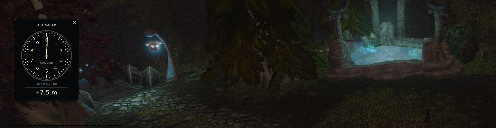
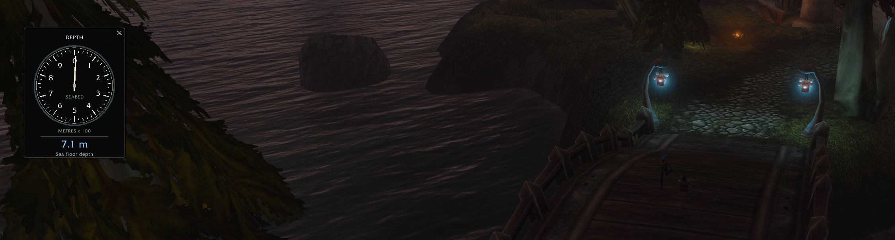

# Altimeter 0.3.0-test

An aircraft-style ground altimeter and automatic **seabed depth gauge**, displaying metres. Data comes from the installed Forever **1.60.1.70862 / wowf** client, not Era or public map height images.

## Gallery

### Ground altitude



The aircraft-style dial displays natural terrain elevation in metres.

### Seabed depth



Over mapped ocean water, the instrument automatically switches to a blue seabed-depth reading—even when standing on a bridge above the water.

## What the instrument measures

On land, the needle and signed number show natural terrain elevation. Over a verified ocean-water cell whose seabed is below the surface, the face changes to **DEPTH / SEABED**, the number becomes blue, and it shows the positive distance from the local ocean surface to the terrain bottom. It works while swimming or underwater, and also when horizontally over mapped ocean water. Returning to dry terrain restores the altimeter automatically.

**Depth is the seabed depth, not your character's diving depth or distance from your feet to the bottom.** The supplied live player-Z readings were zero. Lakes, rivers, pools, lava, moving water and unsupported liquid layouts do not trigger ocean depth mode. Below-zero dry land stays in altitude mode. A terrain hole is unavailable, never invented ground.

Each dial number means 100 metres; a full revolution is 1,000 metres. The number underneath retains the complete value and sign. `~` marks the less precise map-coordinate fallback. Missing data hides the needle and shows `-- m`. The data, debug output and custom calibration command retain WoW yards internally; the display converts at 0.9144 metres per yard.

## Coverage and limits

The expanded dataset contains **3,322 terrain tiles on 48 maps**, including all referenced Eastern Kingdoms (736 tiles) and Kalimdor (988 tiles) terrain and readable Forever-specific terrain maps such as Zephras Isle, Hyjal Crater and Darkspear Islands. Darkshore is included.

This is **all successfully extractable terrain from the readable current-build map catalog**, not a claim of every possible location or walkable surface:

- Eight Map table records are in unreadable encrypted sections. Their identities and terrain coverage are unknown; no older-build records were substituted.
- Maps built entirely from world objects have no ADT terrain to measure: examples include Stockade, Wailing Caverns, Blackfathom Deeps, Uldaman, Gnomeregan, Blackrock Depths, Molten Core and Dire Maul. Their interior floors are unsupported.
- Referenced WDT files for Test Dungeon and Manor Mistmantle were not readable locally. Two transport records have no WDT.
- Where a dungeon has outdoor terrain, that terrain is included, but floors, roofs, bridges, platforms and cave interiors are not. Restricted position APIs can also prevent an instance reading.
- Sea references are established separately per map from accepted ocean records. Where none is established, the face says **World reference**, not sea level. Local ocean masks select depth only where supported water exists.

The complete map-by-map status is in `build-world/coverage.json`; file IDs, hashes, ocean levels and extraction errors are in `build-world/manifest.json`.

The panel automatically hides in the six original capital cities and their child UI maps, plus the two identified Dalaran world maps. It resumes outside those cities unless manually hidden. Resting in a countryside inn does not disable it.

## Install and use

The AddOns list collects the gauge and height library in a collapsible **Altimeter** category. Terrain packs are grouped beneath **Altimeter Height Data**, as six regional modules. Collapse the category using its arrow to hide the full list. The separate packs preserve on-demand loading and the library can still be installed without the gauge.

The updated addon is installed in `_forever_/Interface/AddOns`. **Fully restart WoW** to discover the new world data packs. Enable Altimeter and its data packs. For manual installation, copy all addon directories from the release ZIP into that directory. Remove obsolete `AltimeterForever_W*` and `AltimeterForever_T0_*` folders when upgrading; do not mix databases from different builds.

The package has one display addon, one independent height-data module and six load-on-demand regions: Eastern Kingdoms North/South, Kalimdor North/South, Other World Maps, and Dungeons/Raids/Battlegrounds (eight addon entries total). Data is approximately 570 MB on disk. Only visited regions load; each loads more data at once than the old tile packs, so first entry can pause and use more memory. Loaded regions they stay in memory until reload/logout. The world index uses at most nine candidate tile lookups per update rather than scanning thousands of entries. New packs wait until combat ends before loading. Python, internet and external executables are not needed while playing.

Choose Small, Medium or Large in **Options > AddOns > Altimeter**. The same panel contains visibility, position reset, help and advanced settings. Size, position and visibility are saved. Drag the instrument to move it; the flat cross hides it. Hover to see the toggle hint.

### Sample ahead (test build)

Click the gauge to open direction (-180 to +180 degrees, positive to your right)
and horizontal distance (0-200 metres) sliders. Zero degrees follows your
character's facing, not the camera. While open, the gauge reads the selected
point and says REMOTE TERRAIN; the controls show its height difference from
the terrain beneath you. Closing the controls restores the local reading.
Dragging the gauge still moves it without opening the controls.

A temporary minimap overlay shows a cyan sample cross and connecting line,
with a 10-metre distance grid (50 metres when zoomed out too far for clear
10-metre spacing). A point outside the minimap is labelled rather than given
a misleading edge cross. The grid respects minimap rotation and zoom.

Optional gold contours show 10-metre elevation intervals, with stronger lines
every 50 metres, relative to the gauge's altitude reference. These are an
approximation from a 17-by-17 terrain sample mesh, refreshed every two seconds
or after a substantial move, with a 600-segment limit. Small terrain features
can be missed. Contours describe the terrain, including seabed, not water
surfaces or buildings. They are off by default. Closing/hiding the panel hides
the overlay and stops contour sampling. A first sample in another unloaded
region can pause while its terrain pack loads; new packs still wait in combat.

Commands:

| Command | Effect |
| --- | --- |
| `/alt` or `/altitude` | Toggle visibility |
| `/altitude survey` | Open/close the terrain sampling controls |
| `/altitude rate 0.25` | Update every 0.25 seconds; allowed 0.1–5 |
| `/altitude debug` | Position, map, terrain, water surface, depth and failure diagnostics in yards |
| `/altitude sample note` | Save a labelled diagnostic observation, retaining the last 200 |
| `/altitude datum reset` | Restore the automatic per-map reference |
| `/altitude datum 10` | Set a custom world-Z reference of 10 yards for altitude; ocean depth still uses actual water |
| `/altitude show` / `hide` | Control visibility; city hiding still applies |
| `/altitude reset` | Restore panel position and visibility |

`/reload` or logout saves samples to the account's `SavedVariables/AltimeterForever.lua`. Never edit that file while WoW is running. A client build mismatch disables measurements until the dataset is regenerated.

## Regenerate and validate

Use Python 3.10+, x64 Windows CascLib, and a complete authorized local Forever installation. The extractor performs strict read-only CASC reads and never fills encrypted bytes with zeros. It parses only complete, unencrypted Map sections. It checks the DB2 layouts and liquid-material definitions before decoding oceans.

From this project folder, into a **new empty output directory**:

```powershell
python tools/build_world.py --dll "../cf-ui-research/CascLib/bin/CascLib_dll/x64/Release/CascLib.dll" --storage "C:/Program Files (x86)/World of Warcraft" --output build-world-new --cache local-data
```

Inspect the manifest before installation. Keep the generated output at `build-world` for the package and test commands. `tools/package.py` refreshes code from `addon/`, validates TOC entries and creates the install ZIP with hashes. The original `tools/terrain.py` remains available for a selected single-map pilot extraction.

Development-only tests require Lupa with Lua 5.1 (the existing workspace runtime is supported):

```powershell
python tests/test_terrain.py
python tests/test_world.py
```

The original pilot suite uses `build` and its retained fixtures. The expanded suite uses `build-world`, local-data and the inspected DB2 fixtures. Synthetic geometry exists only in tests, never the shipped database.

On 9 November 2026, the tester confirmed the addon was tested in-game and ready for release. This is user-reported acceptance, not exhaustive verification of every map or terrain coordinate. See `VALIDATION.md` and `RESEARCH.md` for offline validation and coverage limits.

## Components and rights

`addon/` contains the Altimeter display addon (All Rights Reserved; see LICENSE).
`height-module/` contains the independent Altimeter Height Data API and its
limited permission for use, modification and redistribution in other WoW addons.
Generated index/terrain/water packs belong to that module distribution. Third-party
rights are not granted by these licenses. See height-module/README.md for its API.

The full ZIP includes both components. Altimeter-addon is display-only and requires
Altimeter-HeightData. Other addon authors can use Altimeter-HeightData on its own.
A full client restart is required when upgrading to discover the new module.
